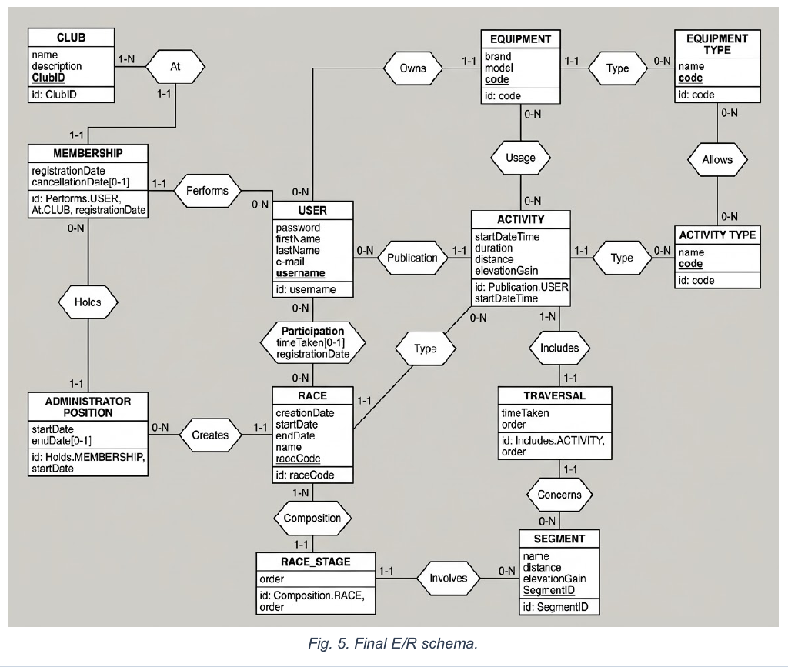

# Workout Tracking Database

A database design and development project for a fitness tracking application inspired by platforms such as Strava. The system allows users to record, upload, and manage their workouts and training activities.

## Project Overview

The project was developed as part of the Database course at the University of Bologna. It focuses on the design and implementation of a relational database for managing sports activities and user-generated training data.

The repository includes the database schema, SQL scripts for data population, a technical report, and a Java application to interact with the database.

## Technologies

- **Database:** MariaDB / MySQL
- **Programming language:** Java
- **Build tool:** Gradle
- **Database language:** SQL

## Application Screenshot


## Entity-Relationship Diagram

[](docs/Report.pdf)

## Repository Structure

- `sql/database.sql` – Database schema and table definitions.
- `sql/popolamento.sql` – Sample data for populating the database.
- `docs/Report.pdf` – Project documentation and database design.
- `app/` – Java application and database interaction logic.

## Setup and Usage

### 1. Database Setup

Start a MariaDB/MySQL server and create the database by running:

```bash
mysql -u root -p < database.sql
```

### 2. Populate the Database

Run the population script:

```bash
mysql -u root -p allenamenti_db < popolamento.sql
```

### 3. Run the Application

From the project root directory:

```bash
./gradlew run
```

The application will prompt for the database credentials at startup.

## Documentation

For a detailed explanation of the database design, requirements, and implementation, see [Report.pdf](docs/Report.pdf).