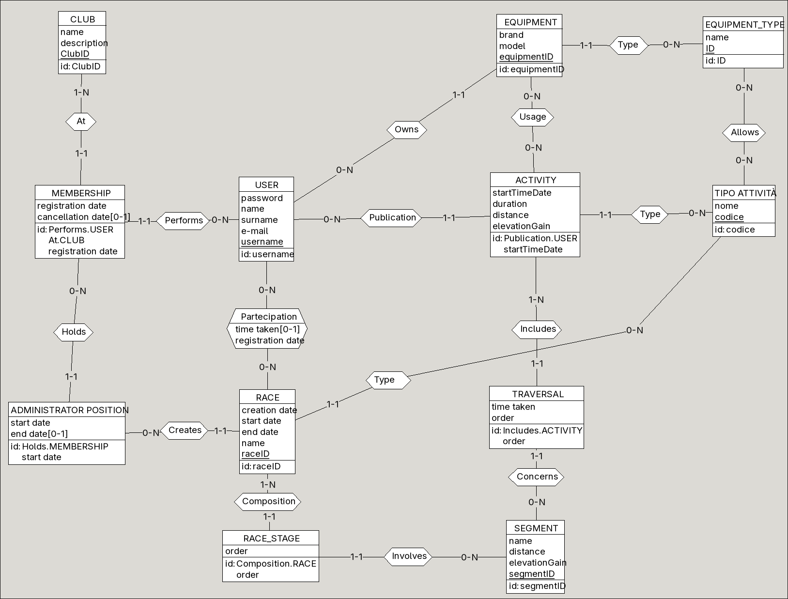
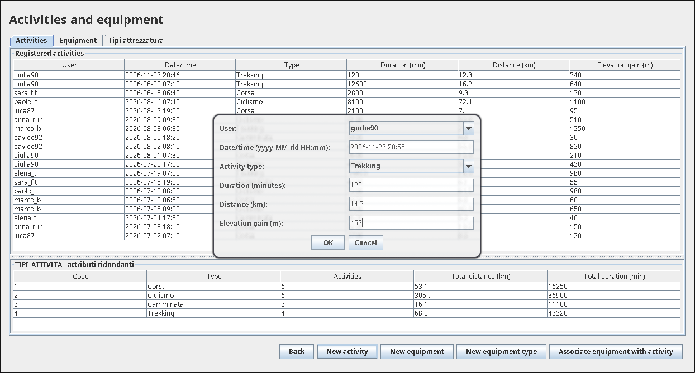

# Workout Tracking Database

A relational database design and Java desktop application inspired by fitness tracking platforms such as Strava, allowing athletes and clubs to record, manage, and analyze workouts, GPS segments, equipment usage, and competitions.

Developed as the final project for the **Databases** (*Basi di Dati*) course in the B.Sc. in Computer Science and Engineering at the **University of Bologna** (Cesena Campus).

---

## Project Overview & Database Design

The project covers the complete database engineering lifecycle—from requirements analysis and conceptual modeling to logical restructuring, normalization, and physical implementation:

* **Conceptual & Logical Modeling:** Designed an Entity-Relationship (E-R) schema covering **14 core domain entities** (Users, Activities/Workouts, GPS Segments, Segment Crossings, Gear/Equipment, Clubs, Competitions/Races, Registrations, Participations, and Performance Reports)[cite: 1].
* **Data Integrity & Optimization:** Enforced primary/foreign key constraints, domain checks, and normalized relational tables to eliminate data redundancy while supporting efficient analytical queries.
* **Analytical & Operational Queries:** Implemented SQL queries to track athlete progress, segment leaderboards, equipment wear, club memberships, and race rankings.

---

## Software Architecture

The companion Java application is structured following the **MVC (Model-View-Controller)** architectural pattern decoupled from persistence via a dedicated **DAO (Data Access Object)** layer over **JDBC**:

* **Model & DAO Layer (`DBModel`, `DAOUtils`, `DAOException`, `Queries`):** Encapsulates SQL statements, connection lifecycle management, and relational-to-object mapping.
* **Controller Layer:** Coordinates user interactions, input validation, and data flow between the GUI and the persistence layer.
* **View Layer:** Desktop graphical user interface for browsing workouts, uploading activities, and inspecting reports.

---

## Tech Stack

* **DBMS:** MariaDB / MySQL
* **Language:** Java (JDK 17+) & SQL
* **Data Access:** JDBC
* **Build Tool:** Gradle (Kotlin DSL)

---

## Entity-Relationship Diagram



---

## Application Preview



---

## Quick Start

### Prerequisites
* **Java Development Kit (JDK)** 17 or higher
* **Docker** & **Docker Compose**

### Run the Application

1. **Clone the repository:**
   ```bash
   git clone https://github.com/jjacomo/workout-tracking-database.git
   cd workout-tracking-database
   ```

2. **Start and automatically initialize the database:**
   ```bash
   docker compose up -d
   ```
   *(MariaDB starts on port `3307`, creates `workout_tracking_db`, builds the schema from `sql/database.sql`, and loads sample data from `sql/populate.sql`).*

3. **Launch the Java application:**
   ```bash
   ./gradlew run
   ```
   *(On Windows, run `gradlew.bat run`).*

